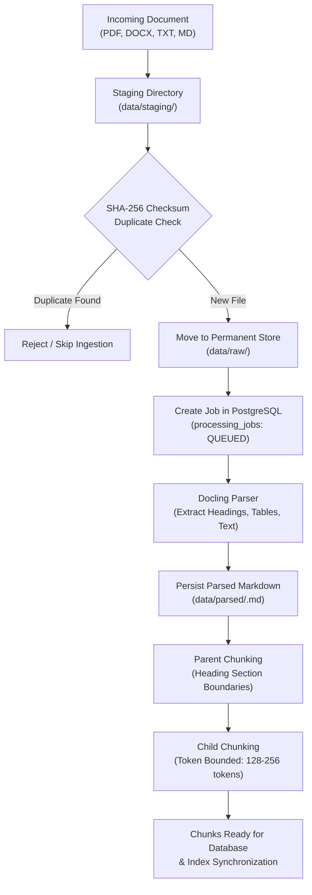
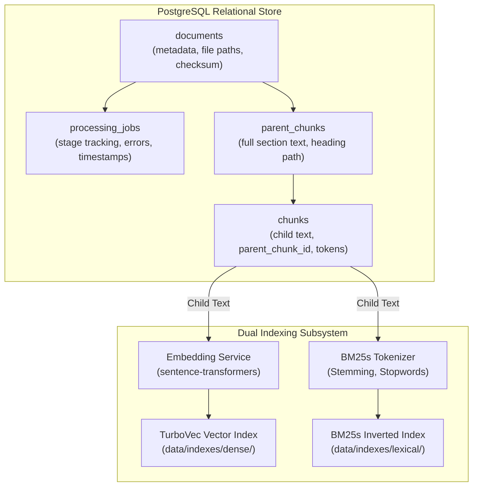
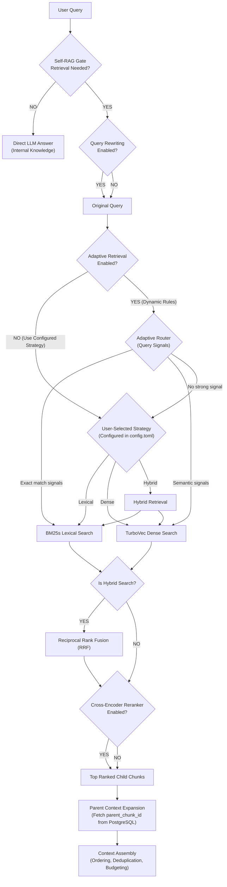
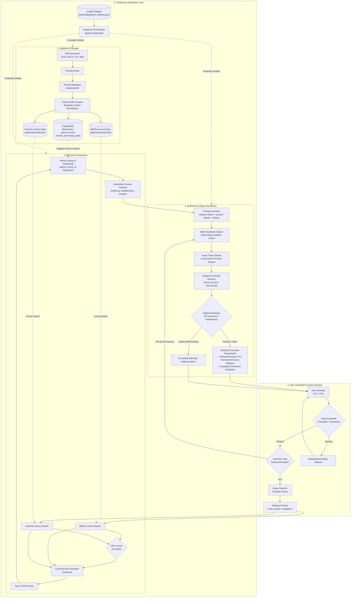

# RAGnarok — System Architecture

> **RAGnarok** is a high-performance, local Python-based Retrieval-Augmented Generation (RAG) system. It combines Docling document parsing, parent-child chunking, configurable retrieval strategies (BM25s lexical search, TurboVec dense vector similarity, or Hybrid fusion), Cross-Encoder reranking, native guardrails, and DeepEval CI/CD evaluation loops.

---

## 1. Ingestion Pipeline

### Description
The Ingestion Pipeline transforms raw, unstructured documents (PDF, DOCX, TXT, Markdown) into structured, search-ready representations. Incoming files are staged and deduplicated using SHA-256 content hashing. **Docling** extracts document layout into normalized Markdown, which is then partitioned into heading-bounded **Parent Chunks** and token-bounded **Child Chunks**. Each stage transitions through the `processing_jobs` state machine in PostgreSQL.

---

## 2. Storage & Indexing Architecture

### Description
RAGnarok uses a decoupled, dual-tier storage strategy:
- **PostgreSQL** serves as the relational metadata store, tracking documents, parent chunk context, child chunk retrieval units, and job lifecycles.
- **Local Filesystem** stores raw source documents, parsed Markdown files, the **BM25s** lexical inverted index, and the **TurboVec** dense vector index.

---

## 3. Query & Retrieval Pipeline

### Description
Queries are optimized prior to retrieval: **Self-RAG** determines whether retrieval is necessary, and **Query Rewriting** clarifies ambiguous wording. **Hybrid mode is not default**; the retrieval strategy is explicitly chosen by the user via configuration (**Lexical**, **Dense**, or **Hybrid**), or dynamically resolved by **Adaptive Retrieval** based on query characteristics. When Hybrid retrieval is selected, results from BM25s and TurboVec are merged via **Reciprocal Rank Fusion (RRF)** and optionally reranked using a **Cross-Encoder**. Finally, **Parent Expansion** fetches the associated parent context from PostgreSQL for the top child matches.

---

## 4. Generation, Evals & Guardrails Architecture

### Description
Safety and quality are enforced at every boundary:
- **Input Guardrails** filter prompt injections, jailbreaks, and off-topic queries before expensive retrieval runs.
- **Generation Layer** formulates a grounded prompt, executes asynchronous token streaming via `litellm` (with multi-model fallback resilience), and maps factual assertions to numbered inline citations (`[1]`, `[2]`).
- **Output Guardrails** scan the generated text for credential/PII leaks and verify factual grounding against context chunks.
- **Evaluation Loop** executes **DeepEval** against a version-controlled Golden Dataset in GitHub Actions to prevent quality regressions.

```mermaid
flowchart TD
    subgraph GuardrailsAndGeneration ["Runtime Generation & Guardrails"]
        RawQuery["Raw User Query"] --> InGuardFast{"Tier 1: Deterministic Guard\n(Length, Escapes, Injections)"}
        InGuardFast -- "Failed" --> InRefusal["Standardized Safety Refusal"]
        InGuardFast -- "Passed" --> InGuardSemantic{"Tier 2: Semantic Guard\n(Topicality & Overrides)"}
        
        InGuardSemantic -- "Failed" --> InRefusal
        InGuardSemantic -- "Passed" --> CoreRetrieval["Core Retrieval & Context Assembly"]
        
        CoreRetrieval --> PromptBuild["Prompt Formulation\n(System Rules + Context Blocks + Query)"]
        PromptBuild --> LLMEngine["litellm Synthesis Engine\n(Multi-Model Fallback Chain)"]
        
        LLMEngine --> TokenStream["Real-Time Token Streaming\n(Sub-500ms TTFT)"]
        TokenStream --> CitationMapper["Citation & Provenance Resolver\n(Inline [1], [2] to Footnotes)"]
        
        CitationMapper --> OutGuard{"Output Guardrails\n(PII Scanner & Faithfulness)"}
        OutGuard -- "Failed (Hallucination)" --> OutFallback["Grounding Warning / Fallback Notice"]
        OutGuard -- "Passed / Redacted" --> FinalOutput["Final Rendered Terminal Output\n• Streamed Grounded Answer\n• Numbered Citations & Footnotes\n• Provenance / Latency Drawer"]
    end

    subgraph CI_CD_Evals ["CI/CD Evaluation Loop (DeepEval)"]
        PR["Pull Request Created"] --> LoadGolden["Load Golden Dataset\n(tests/data/golden_dataset.json)"]
        LoadGolden --> RunDeepEval["DeepEval Test Runner\n(pytest tests/evals/)"]
        RunDeepEval --> Judge["LLM-as-a-Judge\n(Precision, Recall, Faithfulness, Relevancy)"]
        Judge --> EvalGate{"All Scores >= 0.85?"}
        EvalGate -- "YES" --> PRPass["PR Approved"]
        EvalGate -- "NO" --> PRFail["PR Blocked (Regression Detected)"]
    end
```

---

## 5. Complete End-to-End Pipeline

### Description
The master architecture connects document ingestion, relational and vector indexing, secure query handling, user-configured retrieval (Lexical, Dense, or Hybrid based on user selection or dynamic routing), streaming answer synthesis with citation mapping, output safety validation, and automated continuous evaluation into a unified, modular system.

